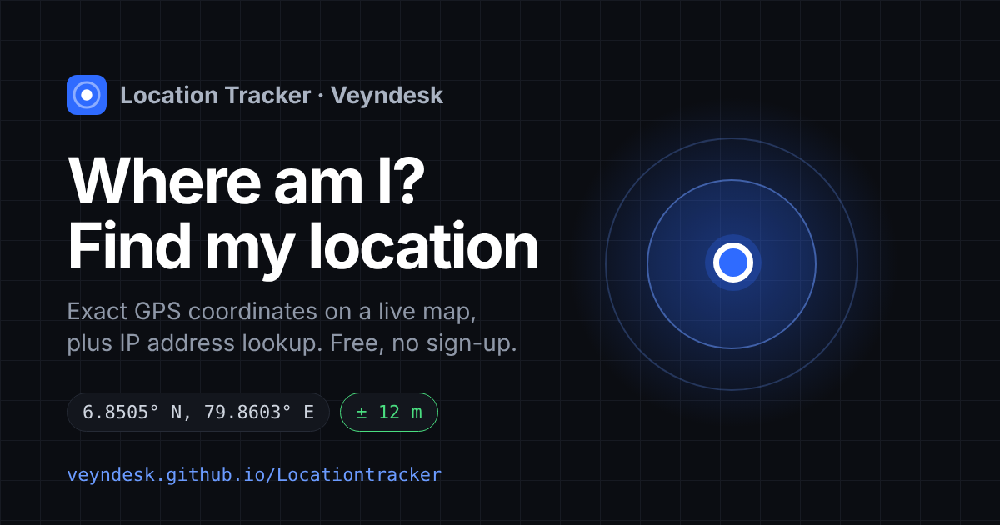

# Location Tracker — Where Am I? Find My Location & GPS Coordinates

[](https://veyndesk.github.io/Locationtracker/)


**👉 Try it: https://veyndesk.github.io/Locationtracker/**

A free online tool by **[Veyndesk](https://github.com/veyndesk)** to **find your current location**,
get your exact **latitude and longitude (GPS coordinates)** on a live map, and **look up the location
of any IP address** (IPv4 and IPv6). No app, no sign-up, nothing stored — everything runs in your
browser.

[](https://veyndesk.github.io/Locationtracker/)

| | Method | Permission | Typical accuracy |
|---|---|---|---|
| **Precise** | `navigator.geolocation.watchPosition` (GPS/GNSS + Wi-Fi) | Required | ± 5–20 m outdoors, ± 20–100 m indoors |
| **Approximate** | Public IP geolocation databases | None | ± 5–50 km, city level |

## Features

- **My location** — watches the device position, keeps the most accurate fix, and stops at a
  target accuracy (default ± 15 m) or a time limit (default 20 s).
- **Live map** (Leaflet + OpenStreetMap) with an accuracy circle around the precise fix and a
  dashed city-level circle for the IP estimate.
- **Accuracy meter** and a **convergence chart** that shows the fix tightening over time.
- **IP lookup** for any IPv4/IPv6 address, with private and reserved ranges rejected up front.
- Light and dark themes, mobile-first layout, copy as JSON / coordinates, open in Google Maps.

## Why `watchPosition` and not `getCurrentPosition`

The first fix a device returns is almost always the coarse one — cached, or derived from nearby
Wi-Fi (± 500–2000 m). The GPS chip needs a few seconds before it reports a real lock, so a single
`getCurrentPosition()` usually returns that coarse fix and stops. This tool keeps watching and
keeps the reading with the lowest `coords.accuracy`.

- `enableHighAccuracy: true` asks for GPS rather than the cheap network fix.
- `maximumAge: 0` refuses a cached position.
- Error `code === 1` (permission denied) is terminal; codes 2 and 3 are not.

## IP geolocation

Requests go straight from the browser to keyless, CORS-enabled HTTPS providers, tried in order:
`ipwho.is` → `ipapi.co` → `get.geojs.io`. Whichever answers first is normalised into one shape.

An IP maps to the location an ISP **registered for a whole range**, not to a device:

- Mobile carriers hand out addresses from a gateway pool; the pin can be hundreds of km away.
- VPNs, proxies and CDNs return the exit node.
- No IP lookup returns a street address.

The IP maps never zoom past city level for that reason.

## Project layout

```
docs/
  index.html            the whole app — UI, styles and logic in one file
  vendor/leaflet/       Leaflet 1.9.4 (BSD-2-Clause), self-hosted
```

## Run locally

Geolocation needs a secure context; `localhost` counts.

```bash
cd docs
python3 -m http.server 8000
# open http://localhost:8000
```

## Deploy

GitHub Pages serves the `docs/` folder of the `main` branch
(Settings → Pages → Deploy from a branch → `main` / `/docs`). Every push to `main` redeploys.

## Privacy

Nothing is stored or sent to a Veyndesk server — there isn't one. The browser talks directly to
the map tile server (OpenStreetMap) and the IP providers listed above. If you extend this to save
locations, do it on an explicit user action and tell people what you keep.

---

© Veyndesk
